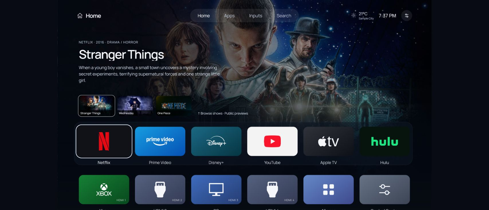
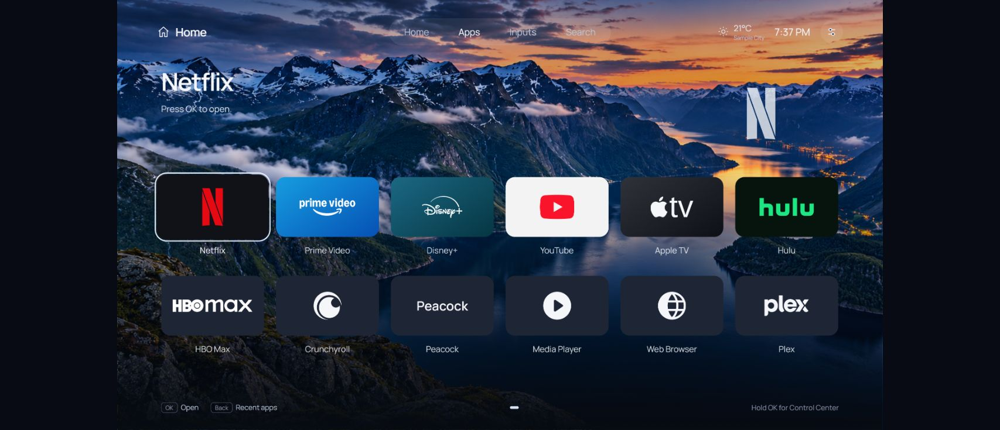

# Rivera Interface Beta

An Apple TV-inspired Home screen for **rooted LG webOS 10 TVs**, built on [Glasshouse](https://github.com/rorygallagher2024/glasshouse), with logo assets from [Lightkeeper](https://github.com/chiotas/lightkeeper).

Large app tiles. Scenic backgrounds. Public show previews. A slower, steadier entrance when Home opens.



**Early beta, version 0.1.0.** The launcher and wake animation were tested on an LG OLED48B5PUA running webOS 10.3.2 / firmware 33.31.75. Other TVs are unverified. The installer refuses other webOS major versions. This replaces the Home interface; it is not an installable Apple tvOS operating system.

## Install

A rooted TV with Homebrew Channel and a working root shell is required. Developer Mode alone is insufficient. The computer needs Python 3.9 or newer, and OpenSSH for the recommended SSH route.

1. Download and extract the [latest beta release](https://github.com/mexicanninja250/rivera-interface-beta/releases). Keep the whole folder together.
2. From that folder, run the prerequisite check, replacing `TV_IP` with the TV's address:

   ```sh
   python tools/deploy.py TV_IP --check
   ```

3. Install:

   ```sh
   python tools/deploy.py TV_IP
   ```

4. Open `http://TV_IP:8080/`. Complete Glasshouse setup if prompted. Preview `http://TV_IP:8080/assets/home.html?preview=1`, then enable **Glasshouse Home** in the dashboard's Home section. The dashboard retains Glasshouse's name for the underlying takeover.

On macOS/Linux, `python3` may be the command name. On Windows, `py` can also be used. If only the Homebrew root telnet shell is available, add `--telnet` to both commands. Telnet is unencrypted and intended only for a trusted local network.

The installer saves a recovery backup before replacing files, verifies every payload checksum, and checks that the server answers. Home takeover is left disabled so the preview and recovery path can be checked first. Existing Homebrew Channel-managed Glasshouse installations are refused; see [installation details](docs/INSTALL.md).

**Read [installation](docs/INSTALL.md) and [recovery](docs/RECOVERY.md) before enabling Home.**

## Included

- Cached app grid and HDMI inputs with device-aware logos.
- Public artwork and descriptions for 15 shows across five streaming services. Selecting a show opens its service app.
- A 1.2-second fade/slide entrance that waits for rendering to settle, with a fail-open safeguard.
- Fjord, Dawn, Night and plain backgrounds; optional slow background motion.
- Clock and approximate-location weather, with automatic Fahrenheit/Celsius selection.
- Home search, a remote-friendly keyboard, and a pointer toggle for this launcher.
- Control Center, recent apps, original LG Home access, and native picture/sound settings access.
- Optional Scenic screensaver with moving time/weather and opt-in local headlines.



See the [screenshot gallery](docs/SCREENSHOTS.md) and [remote controls](docs/CONTROLS.md).

## Scope and performance

The launcher changes Home. Streaming apps, LG settings, the global keyboard/pointer, firmware, HDMI/video drivers and OLED care remain native. The installer does not write picture modes, G-SYNC/VRR, ALLM, eARC or panel-care settings. Preservation on the tested TV is not a compatibility guarantee for every firmware.

The entrance is smoother in the owner's physical power-on test. Measured animation callbacks were approximately 44–47 FPS, with no gaps above 50 ms in six measured entrances. This does **not** establish locked 60 FPS. HDMI returns still spent roughly 2.6–2.8 seconds preparing before the animation. The background can appear before the menu moves in.

Show cards are a small curated catalogue, not live video, personal watch history, or guaranteed current streaming availability. Scenic uses animated still images; the generated Fjord image is 1672×941, not native 4K video. Native input-banner and system-wide sound experiments are not installed by this release.

## Privacy and recovery

The public package contains no TV credentials, serial numbers, personal backups or owner-specific LAN addresses. Weather uses IP-based approximate location through ipwho.is and Open-Meteo; optional headlines use Google News RSS. [Privacy and service details](docs/PRIVACY.md).

The dashboard is local and has no authentication by default. Keep it on a trusted network; never forward port 8080 to the internet. Original LG Home is available through Control Center or by holding Home. An offline root-shell recovery command is documented in [RECOVERY.md](docs/RECOVERY.md).

## Development and credits

```sh
python tests/run.py
python tools/deploy.py --dry-run
```

Node.js is needed for development tests; no Node installation is needed on the computer for deployment. The TV supplies its own Node runtime. See [architecture](docs/ARCHITECTURE.md), [test results](docs/TESTING.md), and [third-party notices](NOTICE.md).

Rivera code is MIT licensed. Glasshouse and Lightkeeper retain their MIT notices; fonts and third-party artwork have their own terms. This is an independent community project, unaffiliated with Apple or LG.
