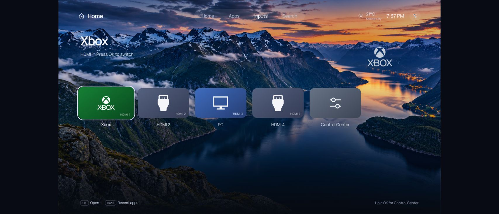
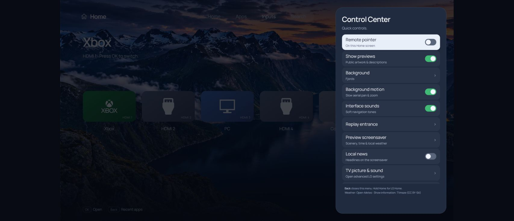
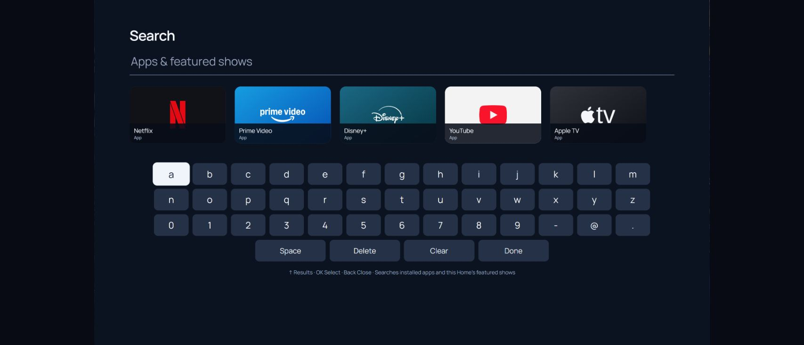

# Interface gallery

These are screenshots of the release's actual Home HTML running in a desktop browser with sample apps, inputs and weather. They show the layout, not a TV frame-rate measurement. The local offline demo is available with `python tools/preview.py`, then `http://127.0.0.1:8766/?preview=1`.

## Home and public show previews

## App library

## HDMI inputs

## Control Center

## Search and keyboard

The Scenic screensaver runs in the TV's native QML surface, so it is not represented by this browser demo. Third-party artwork and trademarks retain their owners' rights; see [notices](../NOTICE.md).
